<picture>
  <source media="(prefers-color-scheme: dark)" srcset="assets/header-dark.svg"/>
  <source media="(prefers-color-scheme: light)" srcset="assets/header-light.svg"/>
  
</picture>

I make small tools, mostly around data and agents.

### Now

**[Cody](https://github.com/baconshow/cody)** 
A desk mascot for Claude Code. It watches what Claude does, and you can talk to it. 
  

**Voxel OS** 
Your agents, projects and memory as a small block world. Coming soon. 
  

**[nexaya-os](https://github.com/baconshow/nexaya-os)** 
Free core of an agentic system for Claude Code. Markdown routers, memory, routines. All local. 
 

**[text2sql-ptbr-lora](https://github.com/baconshow/text2sql-ptbr-lora)** 
QLoRA fine-tune of a 0.5B model for Portuguese Text-to-SQL. 
  

### The long way here

**2009** 
Before any code. Project coordinator at a US consulting firm, in the room with city officials for a US$ 560M metro rail proposal.

**2011** 
Opened my first company.

**2012** 
C++ and C#. Memory by hand, then objects. 
  

**2013** 
GeneXus. You described the model and it wrote the app. Nobody said low-code yet, let alone vibe code. 

**2015 to 2025** 
Ten long years at a mining company. Ran the support team, then IT governance, studied data on the side when Power BI showed up, and moved there for good. When buying a tool was not an option, I built one. 
    

**2025** 
Back on my own. Data pipelines with an LLM in the middle, web and mobile for clients. 
         

**2026** 
Data platforms by day, agents by night. 
      

---

Best way to reach me is an issue on the repo in question.
